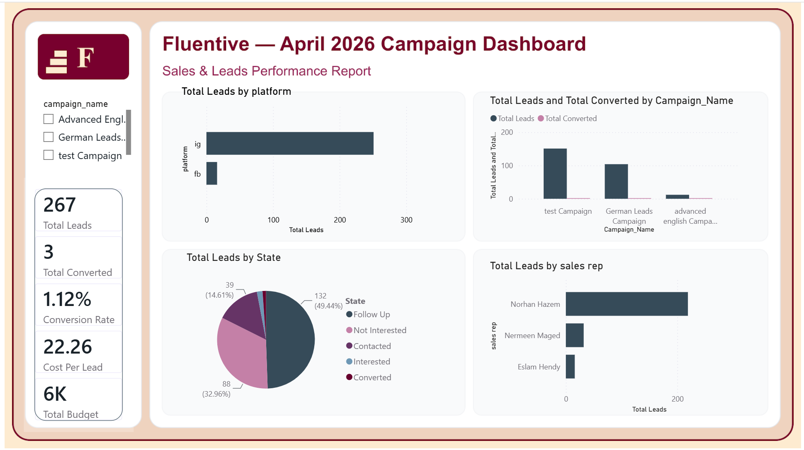

# 📈 Fluentive - Digital Marketing & Lead Conversion Intelligence Dashboard

A digital marketing performance and lead generation analytics dashboard built with **Microsoft Power BI** and **DAX**. The report models the end-to-end sales funnel for Fluentive's April 2026 campaigns: multi-channel lead acquisition, campaign ROI, and sales team conversion efficiency.



## 🎯 Key Performance Indicators (KPIs)

- **Total Leads:** 267 incoming marketing leads across all active channels.
- **Total Converted:** 3 leads converted to paying clients.
- **Conversion Rate:** 1.12% lead-to-customer conversion.
- **Cost Per Lead (CPL):** 22.26 average acquisition cost per lead.
- **Total Budget:** 6K allocated across social advertising campaigns.

## 🔍 Key Findings (April 2026)

- **Conversion is the bottleneck:** only 3 of 267 leads converted (1.12%), while 49.4% of leads are still in `Follow Up` and 33.0% are `Not Interested`. Most of the funnel is unresolved pipeline.
- **Instagram dominates acquisition** with roughly 240 of the 267 leads; Facebook contributes a small fraction, so the channel mix is heavily concentrated.
- **`test Campaign` generated the most leads** (~150), ahead of the German Leads Campaign (~110); campaign-level conversion is near zero across the board.
- **Lead handling is concentrated:** one sales rep (Norhan Hazem) owns the large majority of lead volume, a single-point-of-failure risk for follow-up.

## 📊 Dashboard Visualizations

- **Lead Status Breakdown (Pie Chart):** segmentation by status (`Follow Up`, `Not Interested`, `Contacted`, `Interested`, `Converted`).
- **Sales Representative Performance (Bar Chart):** lead handling volume per sales rep.
- **Platform Acquisition (Bar Chart):** lead volume by platform (Instagram vs Facebook).
- **Campaign Performance (Column Chart):** total leads versus conversions per campaign.
- **Interactive Slicers:** filter by Campaign Name, Date, Study Level, and Delivery Mode (Online vs Offline).

## 🛠 Tech Stack

- **BI Tool:** Microsoft Power BI Desktop
- **Data Modeling:** Power Query (ETL), DAX measures
- **Data Source:** CRM lead tracking and campaign performance data (April 2026)

## 📁 Repository Structure

```text
fluentive-marketing-analytics/
│
├── bi/
│   └── Fluentive_Dashboard_April2026.pbix
├── screenshots/
│   └── campaign-dashboard-april-2026.png
└── README.md
```

## 📁 How to View

1. Download `bi/Fluentive_Dashboard_April2026.pbix`.
2. Open it in **Power BI Desktop**.
